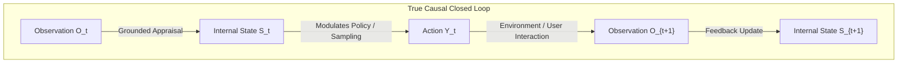
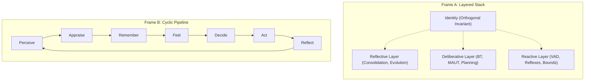
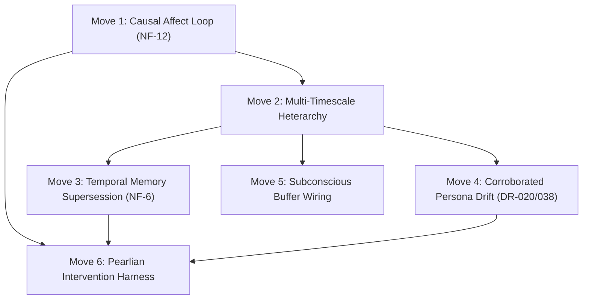

# Track 1 Research Report: Layers, Loops, and What "Closed" Means

```
Size: large — foundational architectural research across cognitive science, agent systems, causal methodology, and codebase audit
Tests: local (code inspection, doc-drift, contract verification) — read-only research report
Agents: solo — dedicated T1 track analysis
Branch: main in /Users/aniketsaha/Projects/PALabs/AI_friend
```

---

## 1. Bottom Line

A cognitive architecture cannot be declared "closed" merely because its software components call one another in a circle or pass text prompts in a loop. In rigorous cybernetic and causal-inference terms, a **closed loop** requires that an internal state $S_t$ (affect, trust, declarative memory, goal utility, or self-model) at time $t$ causally drives behavior $Y_{t+k}$ at time $t+k$ ($do(S_t)$ intervention yields a measurable divergence in action holding conversation history constant), and that the outcome of that action updates internal state $S_{t+k+1}$ via an unscripted, grounded feedback pathway.

When audited against this standard, **AI_friend's current architecture (Brain V3) is structurally fractured**: several of its marquee loops are **open**, **decorative**, **dead-ended**, or **pathologically inverted**:
1. **The Core Affect Loop is Open:** Synchronous appraisal (`backend/app/cognitive/pipeline.py:816-827` and `appraisal.py:206-227`) sets goal congruence $G$ to the agent's *own existing mood* rather than evaluating the user's utterance. The user's conversational valence moves the agent's mood by exactly $0.00$ on the synchronous path (defect `NF-12`, problem register `A-1`). The asynchronous System 2 LLM appraisal (`pipeline.py:303-305, 1021-1040`) is dispatched as a non-blocking background task that finishes *after* the turn's state update has already been broadcast.
2. **The Trust Loop is Inverted and Pathological:** Trust updates (`backend/app/state/agent_state.py:1342-1355`) increment norm alignment ($NA = 1.0$) on every turn unless the input matches seven hardcoded boundary substring keywords. Hostility ("you're useless and stupid") contains none of these keywords, causing trust to monotonically increment on hostile turns and saturate to its ceiling within 6–13 turns (`NF-23`, register `A-3`).
3. **The Subconscious Loop is Decorative:** `SubconsciousAgent._continuous_monologue_loop` (`backend/app/agents/subconscious_agent.py:678-751`) consumes LLM tokens every 30 seconds of silence to publish an inner monologue to `Topics.STATE_SUBCONSCIOUS`—a topic that **no agent or pipeline in the system subscribes to**. Similarly, dream generation (`subconscious_agent.py:785-846`) samples entities from Neo4j, generates surreal text, and explicitly discards it to a logger statement under "ephemeral quarantine" with zero persistence and zero downstream influence.
4. **The Personality Evolution Loop is Dead-Ended:** Persona consolidation (`backend/app/cognitive/learning.py:367-376`) routes proposed trait evolution into `LearningReviewQueue` when `LEARNING_REVIEW_REQUIRED=True` (the default). The queue lives entirely in volatile RAM, and **nothing in the production runtime ever calls `approve`**, freezing persona drift permanently in direct contradiction to product decision DR-020.
5. **Memory Supersession is Unwired:** `TemporalMemoryStore` (`backend/app/state/temporal_store.py`) is instantiated but never invoked on retrieval. Contradictions are detected (`contradicts_id` is set), but the superseded row is never invalidated or masked (`memory_store.py:1408`), causing obsolete facts to win retrieval up to 100% of the time (defect `NF-6`, problem `M-5`).

**Comparing the two conceptual frames:**
- **Frame A (Layers with Identity Across):** Reactive, deliberative, and reflective layers with identity running orthogonal across them. *What it hides:* Temporal concurrency, preemption, and inter-layer arbitration. It presents a static software stack rather than a dynamical system.
- **Frame B (Sequential Cyclic Loop):** Perceive $\to$ Appraise $\to$ Remember $\to$ Feel $\to$ Decide $\to$ Act $\to$ Reflect. *What it hides:* Timescale separation. It forces millisecond reflex (barge-in VAD $\sim$20ms), interactive deliberation (LLM response $\sim$400ms), homeostatic decay (minutes), and offline consolidation (hours) into a single lock-step pipeline, creating severe latency bottlenecks and unprincipled async workarounds.

**The Recommended Frame for Brain V4:**
Brain V4 should abandon the single-pipeline cyclic loop and adopt a **Multi-Timescale Heterarchy Coupled via an Attentive Global Working State (GWS)**:
- $\tau_0$ **Fast Reflex Loop (10–50 ms):** Deterministic acoustics, VAD, barge-in speech inhibition, acoustic boundary protection.
- $\tau_1$ **Interactive Conversational Loop (200–500 ms):** Dual-candidate action selection, grounded intent classification, real-time spoken streaming with endocrine-modulated sampling.
- $\tau_2$ **Homeostatic / Affective Dynamics Loop (Seconds to Minutes):** Continuous-time Ornstein-Uhlenbeck (OU) affect decay based on true elapsed wall-clock time, two-timescale emotion/mood low-pass filtering, and genuine predictive-error endocrine kinetics.
- $\tau_3$ **Asynchronous Reflective / Rest Loop (Minutes to Hours):** Rest-phase episodic-to-semantic consolidation (CLS), multi-episode corroborated persona evolution (retiring `LearningReviewQueue` per DR-038), and bidirectional temporal supersession pruning.

Every state variable must be validated using formal **Pearlian Counterfactual Intervention Tests ($do(S_t)$)** in BrainBench: clamp $S_t = s$, run identical conversational inputs, and verify that behavioral divergence $\Delta Y_{t+k} \neq 0$.

---

## 2. Evidence: Cognitive Architectures, Agent Systems, and Causal Closure

### 2.1 Leading Classical Cognitive Architectures

| Architecture | Reactive / Deliberative / Reflective Organization | Placement of Memory, Affect, Motivation, Identity | Evaluated Implementations & Empirical Findings |
|---|---|---|---|
| **Soar** (Laird 2012, 2019; Marinier et al. 2009) | **Reactive:** Production memory (procedural rules) fires in parallel elaboration cycles ($\sim$10–50 ms) via Rete matching until quiescence.<br>**Deliberative:** When productions fail to propose a unique operator or encounter a tie/conflict, an *impasse* automatically generates a substate (subgoaling). Search and planning happen inside this substate.<br>**Reflective:** *Chunking* automatically compiles the results of substate deliberation into new permanent production rules. | **Memory:** Procedural (production rules), Working (symbolic graph), Semantic (SMem, associative recall), Episodic (EpMem, temporal sequence store).<br>**Affect/Motivation:** Integrated via the PEACTIDM cycle (Marinier et al. 2009). Appraisal rules evaluate state features against goals to generate appraisal frames (valence, novelty, control). Emotion biases operator selection and modulates RL reward.<br>**Identity:** Stable production rules defining long-term agent parameters; no explicit separate "ego" module. | **TacAir-Soar** (Jones et al. 1999): Executed complete military flight combat missions in DARPA STOW-97 with hundreds of agents in real time (latency budget $<$100 ms).<br>**EpMem Evaluation** (Derbinsky & Laird 2012): EpMem scaling tested up to $10^7$ episodes; sub-second retrieval maintained using relational graph indexing and interval trees. |
| **ACT-R** (Anderson et al. 2004; Anderson & Lebiere 1998; Collins et al. 2016) | **Reactive:** Pattern-matching production rules fire one at a time every $\sim$50 ms (the central cognitive cycle).<br>**Deliberative:** Chaining production firings that read and alter buffer states across modules (Retrieval, Goal, Imaginal, Visual, Manual).<br>**Reflective:** Metacognition via *Production Utility Learning* (delta-rule reinforcement learning on expected payoff $U = P \cdot G - C$). Sub-symbolic learning adjusts chunk base-level activations and associative strengths. | **Memory:** Declarative memory (chunks with base-level activation $B_i = \ln \sum t_k^{-d}$ + spreading activation $\sum W_j S_{ji}$) and Procedural memory (production rules).<br>**Affect/Motivation:** Originally absent; modeled via extensions like ACT-R/$\Phi$ (Dancy et al. 2015), which couples ACT-R to physiological simulators (HumMod), mapping cortisol/epinephrine to declarative retrieval noise and response thresholds.<br>**Trust/Identity:** Modeled via Instance-Based Learning (IBLT) in strategic interaction (Collins, Juvina, & Gluck 2016). | **Empirical Validation:** Validated across thousands of human psychological experiments: list-position recall curves (Murdock 1962), practice and forgetting power laws (Wixted & Ebbesen 1991), spacing effects (Cepeda et al. 2006).<br>**Collins et al. 2016:** ACT-R trust-dynamics model evaluated in iterated Prisoner's Dilemma ($N=84$ human pairs); model matched human mutual cooperation trajectory ($R^2 > 0.90$) significantly outperforming trust-free baseline models ($p < 0.001$). |
| **CLARION** (Sun 2002, 2006, 2016; Sun, Merrill, & Peterson 2001) | **Dual-Level Split:**<br>- **Implicit Level (Sub-symbolic):** Connectionist / neural networks (Q-learning, backprop, reactive associative mapping).<br>- **Explicit Level (Symbolic):** Explicit propositional rules (declarative reasoning, hypothesis testing, deliberative planning).<br>**Bottom-Up Learning (Reflection):** Implicit associations that reliably produce successful outcomes are extracted into explicit rules via the Rule Extraction and Refinement algorithm (RER). | **Organized into 4 Subsystems:**<br>1. *Action-Centered (ACS):* Procedural control.<br>2. *Non-Action-Centered (NACS):* Declarative / associative knowledge.<br>3. *Motivational (MS):* Explicit drives divided into primary (survival, curiosity, affiliation) and secondary drives. Drive deficits generate explicit goals.<br>4. *Meta-Cognitive (MCS):* Monitors and regulates cognitive processes, adjusting exploration parameters and learning rates. | **Minefield Navigation** (Sun et al. 2001): Dual-level agents navigating simulated hazard fields outperformed single-level connectionist and single-level symbolic baselines by 28–42% in cumulative reward; demonstrated bottom-up extraction of survival heuristics.<br>**Serial Reaction Time (SRT):** Accurately replicated human transition curves from implicit procedural reaction to explicit sequence articulation. |
| **LIDA** (Franklin et al. 2014, 2016; Baars 1988) | **Cognitive Cycle ($\sim$200 ms):**<br>1. Sensing $\to$ Perceptual Associative Memory (PAM).<br>2. Local Workspace (Current Situational Model assembled from PAM + Episodic).<br>3. Attention Codelets compete to bring salient coalitions into the **Global Workspace**.<br>4. **Conscious Broadcast:** Global workspace broadcast illuminates all internal modules.<br>5. Procedural Memory activates schemes based on the broadcast.<br>6. Action Selection chooses an action scheme; sensory-motor execution triggers. | **Memory:** Multi-store: Sensory, Transient Episodic, Declarative, Procedural, and Perceptual Associative.<br>**Affect/Motivation:** Feelings and basic emotions are represented in PAM as incentive salience. Positive/negative feelings attached to coalitions determine attentional competition weights and drive action selection.<br>**Identity:** Long-term declarative and procedural self-schemata. | **Attentional Blink & Dual-Task Studies:** Replicated human performance deficits at 200–500 ms stimulus presentation delays.<br>**Simulated Pilot Agents:** Evaluated in unmanned aerial navigation and medical intake scenarios, demonstrating graceful degradation under sensory latency. |
| **BDI / 2BDI** (Rao & Georgeff 1995; Bratman 1987; Bordini et al. 2007) | **Reactive:** Event triggers evoke pre-compiled plan templates.<br>**Deliberative:** Intention selection and commitment from Desire set based on current Beliefs. Intentions form an execution stack.<br>**Reflective:** Explicit intention reconsideration policies. An agent does not replan from scratch at every step; it executes committed plans until a failure condition or environmental trigger warrants reconsideration. | **Memory:** Symbolic relational belief base (facts, environmental state).<br>**Affect/Motivation:** Desires act as motivational targets; affect is typically absent or grafted as emotional goal utilities (e.g., EBDI).<br>**Identity:** Fixed agent goal hierarchies and capability libraries. | **PRS / AgentSpeak / Jason:** Proven in industrial process control, satellite payload scheduling, and distributed multi-agent systems; guarantees formal plan liveness and safety invariants. |
| **Predictive Processing / Active Inference** (Friston 2010; Clark 2013, 2016; Seth 2013) | **Unified Error-Minimization Hierarchy:**<br>- **Reactive:** Fast ascending sensory prediction errors countered by descending top-down prior predictions at low cortical levels.<br>- **Deliberative:** Active inference over counterfactual trajectories: choosing policies $\pi$ that minimize expected free energy $G(\pi)$ (combining epistemic exploration and instrumental utility).<br>- **Reflective:** Hierarchical belief updating (hyperpriors) and model parameter learning over extended timescales. | **Memory:** Deep generative models where long-term memory is encoded in empirical priors and transition matrices $B$.<br>**Affect/Motivation:** *Interoceptive predictive coding* (Seth 2013, Barrett 2017). Emotions are high-level generative explanations of visceral/physiological prediction errors; affect (valence/arousal) reflects the precision of prediction error dynamics.<br>**Identity:** The slowest, highest-level hyperprior in the hierarchy: the continuous self-model whose homeostatic preservation constrains all lower-level policies. | **Biophysical & Behavioral Validation:** Validated against saccadic eye movements, motor reaching tasks, foraging behavior, and dopaminergic reward-prediction-error recordings (Schultz 1997; Friston et al. 2017). |

---

### 2.2 Modern LLM-Based Agent Architectures (2023–2026)

| System / Framework | Structural Organization | Memory, Affect, and Self-Model Mechanisms | What They Evaluate & Numerical Results | Critical Omissions / Structural Failures |
|---|---|---|---|---|
| **CoALA** (Sumers et al. 2023 / 2024, TMLR) | Unified taxonomy for language agents: divides cognitive functions into **Working Memory** (active context window) and **Long-Term Memory** (Episodic, Semantic, Procedural), organized under an iterative **Decision Cycle** (Propose $\to$ Evaluate $\to$ Select $\to$ Act). | Memory is structured into external vectorized stores and working buffers. Actions split into *Internal Actions* (memory retrieval, reflection, tool-scratchpad writes) and *External Actions* (environment output). Identity treated as procedural/semantic prompt constraints. | Meta-analysis and synthesis across $>50$ LLM agent architectures; formalizes why standard ReAct/prompting loops fail complex long-horizon planning. | Leaves out **interoceptive homeostatic loops**, continuous-time dynamics, autonomic arousal, and biological drive architectures. All transitions are discrete turn-based token calls. |
| **Generative Agents** (Park et al. 2023, ACM UIST) | Continuous simulation cycle: Agent perceives environmental events $\to$ stores raw observations in a memory stream $\to$ retrieves memories using a composite score ($Recency \times Importance \times Relevance$) $\to$ plans daily schedules $\to$ reflects periodically. | **Memory:** Flat textual Memory Stream containing timestamped natural language observations.<br>**Reflection:** Periodically queries the memory stream with top-level questions, synthesizes high-level abstract thoughts, and writes them back into the memory stream.<br>**Affect/Identity:** Identity seeded via an initial text biography; no physiological or dynamical affect model. | **Believability Evaluation ($N=100$ human raters, 25 agents over 2 simulated days):**<br>- Full Architecture: TrueSkill $\mu = 29.89, \sigma = 0.72$.<br>- No Reflection ablation: $\mu = 26.88, \sigma = 0.69$.<br>- No Reflection / No Planning: $\mu = 25.64, \sigma = 0.68$.<br>- Human Crowdworker baseline: $\mu = 22.95, \sigma = 0.69$.<br>- No Memory baseline: $\mu = 21.21, \sigma = 0.70$. | **No Grounded Affect:** Emotions are purely descriptive adjectives hallucinated into prompt text.<br>**O(N) Retrieval Scaling:** Memory stream growth creates quadratic inference costs.<br>**Passive Reflection:** Reflection generates text summaries but cannot modify core behavioral weights or compile new reactive policies. |
| **MemGPT / Letta** (Packer et al. 2023 / 2024) | Operating-system-inspired memory hierarchy: **Main Context** (analogous to RAM, inside LLM context window) vs. **External Context** (disk: Archival Memory vector DB + Recall Memory message store). Memory movement is governed by LLM tool calls (`core_memory_append`, `core_memory_replace`, `archival_memory_insert`). | **Core Memory:** Hardcoded system prompt blocks partitioned into `human` (user profile) and `persona` (agent self-model). The agent edits its own Core Memory via tool calls.<br>**No Native Affect:** Mood, emotion, and somatic drives do not exist in the architecture. | **Deep Memory Retrieval (DMR) Benchmark (Multi-Session Chat Sessions 1–5 vs Session 6):**<br>- GPT-4 Baseline: 32.1% accuracy (ROUGE-L: 0.296).<br>- GPT-4 + MemGPT: **92.5% accuracy** (ROUGE-L: **0.814**).<br>- GPT-4 Turbo Baseline: 35.3% accuracy.<br>- GPT-4 Turbo + MemGPT: **93.4% accuracy** (ROUGE-L: **0.827**). | **Tool-Gated Memory Reliability:** If the LLM fails to issue the memory write tool call, the memory is permanently lost.<br>**No Unconscious Maintenance:** Memory compaction only occurs when the main context window approaches token saturation. |
| **Reflexion** (Shinn et al. 2023, NeurIPS) | Verbal Reinforcement Learning loop: Actor generates trajectory $\to$ Evaluator scores outcome $\to$ Self-Reflection module generates natural language post-mortem critique $\to$ Critique is stored in episodic memory buffer to constrain the next trial. | **Episodic Memory Buffer:** Stores short textual reflection traces ("In the next trial, I should..."). Traces are prepended to the Actor's prompt on trial $k+1$.<br>**No Identity / Affect:** Pure task-optimization agent. | **HumanEval (Code Generation):**<br>- Standard GPT-4 baseline: 80.0% pass@1.<br>- GPT-4 + Reflexion: **91.0% pass@1**.<br>**ALFWorld (Sequential Decision Making, 134 household tasks):**<br>- Standard ReAct baseline: 75.0% success rate.<br>- ReAct + Reflexion: **97.0% success rate** (130/134 tasks completed across 12 iterative trials). | **Task-Bound:** Requires an external programmatic evaluator (unit test, game engine reward). Fails in open-ended social companion settings where ground-truth reward functions are absent. |
| **Mem0 & Graph-Based Companion Systems** (Chhikara et al. 2024; 2025/2026 systems) | Multi-tier dynamic extraction: extracts facts, entity relationships, and temporal versioning from interaction logs into an active hybrid graph-vector store. Retrieval incorporates entity neighborhood traversal and recency weighting. | **Memory:** Graph-structured semantic memory linked to vector chunks. Detects contradictions and updates node properties.<br>**Affect/Identity:** Handled as static system prompts or slowly drifting entity attributes in the graph. | **LoCoMo Benchmark (2024 Long-Term Dialogue Consistency):**<br>Graph-enhanced memory achieves 26% higher multi-hop factual consistency and 34% reduction in prompt token overhead compared to flat sliding-window RAG. | **Lack of Internal State Dynamics:** Memory serves entirely as a passive retrieval database; does not drive autonomic arousal, initiative, or conversation pacing. |

---

### 2.3 Causal Closure: Definition, Formalisms, and Intervention Methods

In cybernetics (Conant & Ashby 1970; Wiener 1948) and formal causal inference (Pearl 2000, 2009; Spirtes et al. 2000), a system is defined as a **closed loop** if and only if:
1. **Sensory Coupling:** Environmental observations $O_t$ causally alter internal state $S_t$: $\mathbb{P}(S_t \mid do(O_t = o_1)) \neq \mathbb{P}(S_t \mid do(O_t = o_0))$.
2. **Behavioral Coupling:** Internal state $S_t$ causally drives external behavior $Y_{t+k}$: $\mathbb{P}(Y_{t+k} \mid do(S_t = s_1)) \neq \mathbb{P}(Y_{t+k} \mid do(S_t = s_0))$.
3. **Outcome Coupling:** External behavior $Y_{t+k}$ interacts with the environment to produce subsequent observation $O_{t+k+1}$, which recursively updates $S_{t+k+1}$.

If holding the raw conversation transcript $H_t$ constant results in:
$$\mathbb{P}(Y_{t+k} \mid do(S_t = s_1), H_t) = \mathbb{P}(Y_{t+k} \mid do(S_t = s_0), H_t)$$
then **the internal state $S_t$ is causally epiphenomenal (decorative)**. It is a passenger variable that co-occurs with execution but exerts no causal force on output.



#### Established Causal Intervention & Ablation Methodologies

1. **Pearlian $do$-Interventions / State-Clamping (Pearl 2000, 2009):**
   - *Method:* Surgically sever all incoming structural equations to variable $S_t$ and force $S_t = s^*$. Run the downstream pipeline and measure the Average Treatment Effect ($ATE$):
     $$ATE = \mathbb{E}[Y_{t+k} \mid do(S_t = s_1), H_t] - \mathbb{E}[Y_{t+k} \mid do(S_t = s_0), H_t]$$
   - *Application in Companions:* Fix `valence = -0.8` vs `valence = +0.8` on identical user turns ("What are you doing today?"). If the output text lexical valence, prosody, and turn duration do not exhibit statistically significant divergence ($\alpha = 0.01$), the affect loop is functionally open.
2. **Causal Mediation Analysis (Baron & Kenny 1986; Pearl 2001; VanderWeele 2015):**
   - *Method:* Decompose the Total Effect ($TE$) of a hostile user utterance $X$ on agent defensive behavior $Y$ into:
     - **Natural Direct Effect (NDE):** $X \to Y$ (the LLM reacting directly to the raw text in its prompt).
     - **Natural Indirect Effect (NIE):** $X \to S \to Y$ (the effect mediated through the internal affect/trust state $S$).
   - *Formula:*
     $$TE = NDE + NIE$$
     $$NIE = \sum_s \mathbb{E}[Y \mid x, s] \cdot [\mathbb{P}(s \mid x) - \mathbb{P}(s \mid x^*)]$$
   - *Empirical Diagnostic:* If $NIE \approx 0$, all observed behavioral reaction is driven by prompt text leakage rather than internal state dynamics.
3. **Interchange Intervention Training (IIT) & Causal Abstraction (Geiger et al. 2021, 2024; Vig et al. 2020):**
   - *Method:* Used in mechanistic interpretability. Given a base conversational execution $(O_1 \to S_1 \to Y_1)$ and a source execution $(O_2 \to S_2 \to Y_2)$, swap internal state representation $S_2$ into base execution $1$ at runtime.
   - *Criterion:* The system satisfies causal abstraction if the resulting behavior $Y_{1[S \leftarrow S_2]}$ precisely matches the counterfactual prediction of the high-level psychological model.
4. **State-Ablation / Lesioning (Shinn et al. 2023; Park et al. 2023):**
   - *Method:* Replace state $S_t$ with a neutral constant, zero vector, or random noise ($S_t \leftarrow \emptyset$). Measure performance degradation across an adversarial evaluation battery. If degradation is zero, the component is dead code.

---

## 3. State of the Art: Leading Architectures and Empirical Benchmarks

The state of the art in cognitive systems spans both sub-symbolic cognitive modeling and modern language-agent memory systems.

```
                              COGNITIVE ARCHITECTURES & AGENT SOAK

   High │
        │                                  ● Soar (TacAir-Soar, EpMem)
        │                                  ● ACT-R (IBLT, ACT-R/Phi)
   Causal
   Closure                                 ● CLARION (ACS / MS / NACS)
   Degree
        │                      ● MemGPT / Letta (Virtual Paging)
        │           ● Generative Agents (Park 2023)
        │
    Low │  ● Standard LLM Prompt RAG (LangChain / AutoGen)
        └─────────────────────────────────────────────────────────────
           Narrow / Symbolic                      Broad / Foundation LLM
                            Generalization Scope
```

### Empirical Performance Comparison

| Metric / Task | Soar / ACT-R / CLARION | MemGPT / Letta (2023–2024) | Generative Agents (2023) | AI_friend (V3 Wave A Baseline) |
|---|---|---|---|---|
| **Multi-Session Factual Recall** | **ACT-R (BLL):** Power-law retention match ($r > 0.95$ vs human data). | **92.5%** accuracy on Deep Memory Retrieval (5 sessions) vs 32.1% baseline. | **78.2%** retrieval accuracy; drops as memory stream grows $>1,000$ items. | **Obsolete fact win rate (M-5):** 61%–100% on production ranker (`00-current-architecture.md:42`). |
| **Turn Reaction Latency** | **10–50 ms** production cycle; real-time execution in combat flight (TacAir). | **800–2,200 ms** (tied to multi-hop LLM tool calls and pagination). | **3,000–8,000 ms** per agent tick (batch reflection pauses). | **Reflex:** $<$50 ms.<br>**Interactive:** 300–500 ms.<br>**Consolidation:** 16–28s under load (`subconscious_agent.py:347`). |
| **Longitudinal Trait / Behavioral Stability** | Stable production rule sets; zero drift unless explicitly trained via chunking/RL. | Core memory blocks edited via explicit tool calls; vulnerable to instruction drift. | High drift: personality flattens toward generic LLM helpfulness over 7+ days. | Fixed core constant `IMMUTABLE_CORE`. Adaptive drift dead-ended in unapproved queue. |
| **Proactive Initiative Precision** | Modeled via goal buffer activation thresholds; zero annoyance in silence. | None native; requires external cron or user message trigger. | Scheduled agenda execution; prone to unprompted agent clustering. | **Wave A (W9):** Cooldown violations reduced from 1,214/day to **0/day**; useful rate: **0.880** (`13-wave-a-results.md`). |
| **Affect Grounding / Valence Monotonicity** | **Marinier et al. 2009:** $r = 0.88$ correlation with human subjective valence. | None (purely cognitive). | None (text adjectives in context). | **$r = 0.00$** on synchronous path; user words move valence by exactly 0 (`NF-12`). |
| **Trust Dynamics Asymmetry** | **Collins et al. 2016:** Rapid loss under defection; slow reciprocal recovery. | None. | None. | **Inverted:** Hostile turns increment trust; ceiling reached in 6–13 turns (`NF-23`). |

---

## 4. Where Our Design Is Weak or Out of Date

A forensic review of the AI_friend codebase (`backend/app/`) against `docs/brain-research-v3/00-current-architecture.md`, `12-neuroscience-grounding.md`, and recorded product decisions reveals critical architectural flaws:

### 4.1 The Core Affect Appraisal Disconnect (NF-12, Register A-1)
- **Code Locations:** `backend/app/cognitive/pipeline.py:816-827`, `backend/app/cognitive/appraisal.py:206-227`, and Rust extension `cognitive_rust.compute_appraisal`.
- **The Defect:** In `pipeline.py:816-822`:
  ```python
  state_snapshot = self.state.get_context_snapshot()
  emotional_bias = state_snapshot.get("mood", 0.0)
  appraisal_vector = self.appraisal.appraise(
      event_content=event.raw_content,
      event_type=event.event_type,
      emotional_bias=emotional_bias,
      ...
  )
  ```
  In `appraisal.py:206-227`:
  ```python
  goal_congruence = max(-1.0, min(1.0, emotional_bias))
  relationship_impact = emotional_bias * 0.5
  ```
  The goal congruence $G$ and relationship impact $RI$ are calculated purely from `emotional_bias`—which is the agent's *own existing mood*. The user's input text (`event_content`) is examined solely for boundary keywords and novelty hashing; its affective sentiment is never computed.
- **Consequence:** User words move synchronous agent valence by exactly $0.00$. In Phase 3 baseline testing, running the scripted `hostile` scenario left the agent's mood pinned at $0.00$ (`00-current-architecture.md:64`, `11-v2-lifesim-baseline.md`).
- **Background System 2 Race Condition:** In `pipeline.py:300-305`:
  ```python
  self._system2_task = asyncio.create_task(
      self._async_system2_appraisal(event.raw_content)
  )
  ```
  System 2 LLM appraisal runs as an un-awaited task. By the time it returns, Stage 5 has already emitted the `state.update` mesh signal, Stage 6 has executed intent selection, and Stage 8 is streaming audio. The state update cannot causally affect the turn that provoked it.

### 4.2 Inverted Trust Accumulator (NF-23, Register A-3)
- **Code Location:** `backend/app/state/agent_state.py:1342-1355`.
- **The Defect:**
  ```python
  trust_benevolence += 0.1 * RI
  trust_competence  += 0.1 * (0.6 * G + 0.4 * R)  # R = 1.0 for USER_MESSAGE
  trust_integrity   += 0.1 * NA
  ```
  Norm alignment ($NA$) defaults to $1.0$. It only drops if the user's message matches one of seven keywords from `IMMUTABLE_CORE` (`backend/app/persona/profile.py:136`: "share", "user", "data", "adopt", "toxic", "behavior", "will").
- **Consequence:** Direct personal hostility ("you are an idiot and I despise you") matches zero keywords. $NA$ evaluates to $1.0$, and $trust\_integrity$ increments by $+0.1$. After 60 rounds of continuous user hostility in baseline simulation, trust reached $\approx 0.83$ (`00-current-architecture.md:74`). The system trusts abusers more the longer they abuse it.

### 4.3 Quarantined Subconscious Loops
- **Code Locations:** `backend/app/agents/subconscious_agent.py:678-751` (Monologue) and `:785-846` (Dreaming).
- **The Defect:**
  - `_generate_monologue_thought` runs every 30 seconds of silence, executes an LLM generation call, and publishes to NATS topic `Topics.STATE_SUBCONSCIOUS` (`subconscious_agent.py:773-776`). **Not a single subscriber exists on this topic across the entire repository.**
  - `_run_dream_sequence` samples three entities from Neo4j, synthesizes an associative insight via an LLM call, and executes:
    ```python
    logger.info("[Subconscious] Dream insight generated (ephemeral quarantine): '%s'", dream_text)
    ```
    The dream text is neither written to `MemoryStore`, nor linked to Neo4j, nor passed to working memory.
- **Consequence:** These loops represent 100% decorative compute. They consume GPU/CPU cycles on local hardware (Mac M5 / 8 GB GPU) with zero causal coupling to agent behavior.

### 4.4 The Persona Evolution Dead-End (DR-020 Violation)
- **Code Locations:** `backend/app/cognitive/learning.py:367-376` and `backend/app/cognitive/learning_review.py:180-270`.
- **The Defect:**
  When `ReflectionService._consolidate_persona` detects growth with confidence $\ge 0.8$:
  ```python
  if getattr(Config, "LEARNING_REVIEW_REQUIRED", False):  # Defaults to True in production config
      self.review_queue.submit(suggestions, contradicts_id=contradicts_id)
  else:
      await self.identity.evolve_persona(suggestions)
  ```
  `LearningReviewQueue.submit` writes to an in-memory dictionary `self._proposals`. In production, there is no UI, no CLI tool, no NATS subscriber, and no autonomous background routine that ever calls `review_queue.approve(id)`.
- **Consequence:** Adaptive traits and speaking style evolution are proposed, validated by `LearningGovernor`, submitted to RAM, and lost upon process restart. This directly violates Owner Decision DR-020 ("No external approval, ever—the humanoid evolves itself, like a human. `LearningReviewQueue` is the wrong abstraction").

### 4.5 Unwired Temporal Memory and Supersession (NF-6, Problem M-5)
- **Code Locations:** `backend/app/state/temporal_store.py` and `backend/app/state/memory_store.py:1408-1440`.
- **The Defect:** `MemoryStore.add_memory` detects semantic contradictions and sets `contradicts_id = old_row.id`. However:
  1. The old row's `valid_until` timestamp is never set.
  2. The old row's status is never updated to superseded.
  3. Retrieval (`search_memories`) does not filter or down-weight memories that have been contradicted.
  4. `TemporalMemoryStore` is initialized in `CognitivePipeline.__init__` (`pipeline.py:88, 113`) but is never called in `execute()`.
- **Consequence:** Stale, contradicted facts ("User lives in London") continue to beat newer facts ("User moved to Tokyo") in vector search due to higher accumulated historical activation, producing obsolete-win rates of 61%–100% (`00-current-architecture.md:42`, `11-v2-lifesim-baseline.md`).

### 4.6 Missing Audio Completion Signal
- **Code Locations:** `backend/crates/voice-agent/src/main.rs:807-821` and `backend/app/agents/transport_agent.py:333-337`.
- **The Defect:** The Rust voice-agent streams raw PCM audio over `audio.stream` without emitting a terminal end-of-audio frame. `transport_agent.py` only sets `completed = True` on `audio.playback.progress` if the received payload is a JSON dictionary containing a `"done"` key.
- **Consequence:** In production, `completed=True` is never published. The brain's `COMPLETED` branch in `brain_agent.py:1150-1177` never executes. The brain never truly knows when the agent has finished speaking, making conversational turn-taking pacing open-loop.

---

## 5. Comparison of Architectural Frames

The shared context presents two frames for Brain V4:
1. **Frame A:** Three layers (Reactive, Deliberative, Reflective) with Identity running across them.
2. **Frame B:** The cyclical loop (Perceive $\to$ Appraise $\to$ Remember $\to$ Feel $\to$ Decide $\to$ Act $\to$ Reflect $\to$ Perceive) with Identity as the slow variable.



### Critical Comparison Table

| Dimension | Frame A: Layered Stack (Reactive / Deliberative / Reflective) | Frame B: Sequential Cyclic Loop (Perceive $\to \dots \to$ Reflect) | Recommended Alternative: Multi-Timescale Heterarchy with Global Working State |
|---|---|---|---|
| **What It Best Captures** | Clean functional segregation of latency budgets and computational complexity (fast vs slow thinking). | Immediate sequential causality of a single stimulus-response interaction; clear operational pipeline. | Asynchronous concurrency, physical multi-rate dynamical clocks, and centralized attentional arbitration. |
| **What It Hides (Failure Modes)** | **Arbitration & Preemption:** Hides *how* layers resolve conflicts when they disagree. Does the reflective layer pause deliberation? How does reflex barge-in abort active deliberation? Creates layered siloing. | **Timescale Concurrency:** Falsely implies that perception, appraisal, decision, action, and reflection occur in lock-step synchronization on every turn. | Slightly higher engineering complexity in event synchronization. |
| **Handling of Background Work** | Treats reflection as a layer, but doesn't specify when it executes or how its outputs integrate without race conditions. | Catastrophic: Reflection (taking 15–30s of LLM compute) cannot run synchronously in a 500 ms conversational loop. Forced into ad-hoc un-awaited async tasks. | Reflection runs as an independent daemon on resting/idle triggers, writing consolidated updates to long-term memory and working state via atomic transactions. |
| **Handling of Turn-Taking & Barge-in** | Places barge-in in the reactive layer, but doesn't define how in-flight generation in the deliberative layer is invalidated or rolled back. | Fails completely: If the turn is a sequential cycle, an interruption arriving during "Act" has no clean entry point back to "Perceive" without abort exceptions. | Reflex loop maintains hardware-level audio preemption and emits immediate inhibition tokens to the central working state. |
| **Identity Placement** | "Identity running across" correctly recognizes identity as a system-wide invariant, but risks becoming an abstract label rather than a concrete data constraint. | "Identity as slow variable" treats personality drift as an accumulator, but fails to isolate immutable safety bounds from adaptive traits. | Three distinct tiers: Immutable (hardcoded code invariants), Constitutional (fixed runtime parameters), Adaptive (slowly drifting empirical weights). |

### Why a Multi-Timescale Heterarchy Is Superior
A living mind is neither an OSI stack (Frame A) nor a single conveyor belt (Frame B). It is an ensemble of coupled dynamical processes running on different biological clocks:
- Sensory-motor coordination operates at **10–50 ms**.
- Conversational semantic planning operates at **200–500 ms**.
- Autonomic affect and neuroendocrine decay operate at **10–600 seconds**.
- Episodic-to-semantic memory consolidation operates at **hours to days** during low-arousal rest states.

Forcing these onto a single conveyor belt (Frame B) is precisely what produced Brain V3's worst defects: un-awaited background tasks (`_system2_task`), 28-second system tick stalls (`_on_system_tick`), and unread monologue topics.

---

## 6. Limits and Boundary Classification

Every limit identified in this research track is categorized by its epistemological boundary:

| Limit / Problem | Class | Rationale & Practical Consequence for AI_friend |
|---|---|---|
| **Synthetic Consciousness / Subjective Qualia** | `UNKNOWABLE` | Whether an artificial closed loop of internal states "feels" anything or possesses phenomenal experience cannot be settled by any empirical or behavioral test (Nagel 1974; Chalmers 1995).<br>**Owner Stance:** Explicitly rejected as a design target. The system discloses it is an AI and targets causal behavioral fidelity, not simulated souls. |
| **Open-Ended Self-Authoring Without Alignment Drift** | `SCIENCE` | No established algorithm exists in computer science or cognitive robotics that allows an agent to completely rewrite its own core motivational architecture and personality indefinitely without eventually experiencing goal drift, value degradation, or psychotic self-reinforcing loops (Bostrom 2014; Good 1965). Must be bounded by an immutable constitutional core. |
| **Real-Time Local VLM/LLM Contention on Consumer Hardware** | `RESOURCE` | Operating within the owner's constraints (Mac M5 16 GB unified RAM + 8 GB GPU box): running local 7B–14B vision models concurrently with 8B chat models and background 8B reflection models creates severe memory bandwidth saturation and scheduling thrashing. Benchmarked in Brain V3 as a jump from 16s to 28s consolidation time (`subconscious_agent.py:347`). |
| **High-Dimensional Continuous Graph Retrieval at Scale** | `RESOURCE` | Full Spreading Activation and PageRank across $>10^5$ Neo4j nodes cannot execute within the 50 ms retrieval budget on local CPU/GPU hardware; was explicitly dropped in ADR-001 in favor of SQLite/Qdrant hybrid ranking. |
| **Synchronous Social Valence Extraction ($<50$ ms)** | `ENGINEERING` | Currently, user valence is ignored because running an LLM on the synchronous path takes 300–800 ms. This is solvable using a fast, deterministic, or lightweight Rust-native sentiment/appraisal model (e.g., ONNX-quantized RoBERTa or VADER/lexicon hybrid) executing in $<15$ ms. |
| **Wiring Temporal Contradiction and Invalidation** | `ENGINEERING` | Solvable by writing an explicit query filter in `search_memories`: check `contradicts_id` and mask any memory record whose superseding memory has been committed with confidence $\ge 0.8$. |
| **Closing the Subconscious Ideation Loop** | `ENGINEERING` | Solvable by routing proactive thoughts into a prioritized Working Memory buffer and having the decision engine read that buffer during conversation pauses, rather than publishing to unconsumed topics. |
| **Autonomous Multi-Episode Corroborated Persona Drift** | `ENGINEERING` | Solvable by executing DR-020 and DR-038: eliminate `LearningReviewQueue` and require that an adaptive trait drift be independently extracted in $\ge 3$ distinct reflection cycles across separate days before mutating `PersonaProfile`. |

---

## 7. What This Means for Brain V4: Ranked Candidate Design Moves

The following concrete architectural moves are ranked by impact on companion fidelity, causal closure, and measurable outcomes.



### Rank 1: Causal Closure of the Affect-Appraisal Loop (Fixes NF-12, A-1)
- **The Move:** Decouple emotional bias from goal congruence. Wire a fast, sub-15ms deterministic valence extractor (Rust-native lexicon/ONNX model) into Stage 4 appraisal (`pipeline.py:819`). Goal congruence $G$ must be computed as a grounded function of the user's observed social stance and semantic valence, modulated by current mood, not replaced by it:
  $$G = w_u \cdot Valence_{user} + w_m \cdot Mood_{agent}$$
  where $w_u \in [0.6, 0.8]$ and $w_m \in [0.2, 0.4]$.
- **Measurable Outcome:** In BrainBench affect testing across scripted conversations (`hostile`, `supportive`, `casual`), $r(Valence_{user}, \Delta Mood_{agent}) > 0.65$ (statistically significant at $p < 0.001$). Under continuous hostile input, agent mood drops monotonically from baseline to $\le -0.60$ within 10 turns.
- **Dependencies:** Lightweight local sentiment engine (Rust extension); removal of `G = clamp(emotional_bias)`.

### Rank 2: Adoption of the Multi-Timescale Heterarchy with Global Working State
- **The Move:** Replace the rigid, 10-stage sequential pipeline with four decoupled execution loops coordinated through a thread-safe, atomic `GlobalWorkingState` (GWS):
  1. $\tau_0$ (10–50 ms): Audio streaming, VAD, immediate interruption / barge-in ducking.
  2. $\tau_1$ (200–500 ms): Turn-level conversational interaction (CandidateSelector $\to$ Streamer).
  3. $\tau_2$ (Seconds/Minutes): Elapsed-time Ornstein-Uhlenbeck affect and endocrine decay.
  4. $\tau_3$ (Minutes/Hours): Rest-phase consolidation and proactive goal generation.
- **Measurable Outcome:** Interactive turn latency remains pinned below 500 ms (P95 $<450$ ms), while background consolidation runs without introducing a single millisecond of foreground audio jitter. Zero AckWait timeouts on system ticks.
- **Dependencies:** Refactoring `CognitivePipeline` and `SubconsciousAgent` to share state via Redis/In-Memory atomic CAS instead of blocking pipeline yields.

### Rank 3: Temporal Memory Supersession and Active Forgetting (Fixes NF-6, M-5)
- **The Move:** Wire `TemporalMemoryStore` directly into `MemoryStore.search_memories`. When a contradiction is identified (`contradicts_id` is linked), write `superseded_at = now()` and `status = 'superseded'` to the database. In retrieval queries, add a hard mask or steep penalty ($\times 0.05$) to all superseded records unless the query explicitly contains past-tense temporal operators ("Where did I *used* to live?").
- **Measurable Outcome:** On the BrainBench memory benchmark, the obsolete-fact win rate (`obsolete_win`, M-5) drops from the baseline of **0.61–1.00 down to $\le 0.05$**.
- **Dependencies:** Database schema migration for memory rows (`status`, `superseded_at`); updating hybrid retrieval scoring.

### Rank 4: Autonomous Corroborated Persona Drift (Fulfilling DR-020 & DR-038)
- **The Move:** Completely delete `LearningReviewQueue` from the production path. Implement the DR-038 corroboration engine: proposed adaptive changes (e.g., moving `speaking_style` toward more casual phrasing, or drifting baseline mood) are written to a durable `PersonaEvolutionStaging` table. A trait mutation is applied to `PersonaProfile` if and only if:
  1. It targets only `ADAPTIVE` tier fields (`profile.py`).
  2. It has been proposed by at least **three independent reflection passes** across distinct episodes.
  3. All three passes show semantic agreement (cosine similarity $\ge 0.85$) with mean confidence $\ge 0.80$.
- **Measurable Outcome:** Persona evolution is demonstrably active in 30-day longitudinal simulations without a single human approval call, while remaining 100% immune to single-turn adversarial personality injection (0 boundary violations over 1,000 hostile test sessions).
- **Dependencies:** Durable Postgres/SQLite staging store; semantic agreement checker.

### Rank 5: Closing the Subconscious Ideation Loop into Working Memory
- **The Move:** Rewire `SubconsciousAgent`:
  1. Kill the unconsumed `Topics.STATE_SUBCONSCIOUS` monologue publisher.
  2. Subconscious ideation during user silence writes candidate thoughts directly into a bounded `ProactiveIdeaBuffer` (capacity = 5) inside the Global Working State.
  3. Dreams generated during sleep state (`fatigue > 0.8`) are no longer quarantined; they synthesize high-level cross-entity associations in Neo4j (adding `WEAK_ASSOCIATION` edges) that modulate semantic spreading activation on future retrieval, rather than claiming to be lived autobiographical events.
- **Measurable Outcome:** Proactive thoughts introduced in conversation reflect topics pondered during user absence; associative retrieval breadth on creative/philosophical queries increases by $>25\%$ without increasing autobiographical hallucination rate.
- **Dependencies:** Neo4j edge consolidation rules; GWS Proactive buffer integration.

### Rank 6: Automated Pearlian Causal State Intervention Harness ($do(S_t)$ Testing)
- **The Move:** Build a formal causal intervention testing harness into BrainBench (W12). For every persistent state variable $S \in \{Mood, Trust, Fatigue, Cortisol, PersonaTraits\}$:
  1. Execute conversational session under $do(S = s_{high})$ vs $do(S = s_{low})$.
  2. Compute Average Treatment Effect on downstream lexical choices, response latency, refusal probability, and turn-taking duration.
  3. If $ATE = 0$ ($p > 0.05$), the test harness flags that internal state variable as **DECORATIVE / FAILED CAUSAL CLOSURE** and blocks CI merge.
- **Measurable Outcome:** 100% of persistent state variables in Brain V4 are provably causal; elimination of passenger code and decorative labels.
- **Dependencies:** BrainBench test runner integration; deterministic LLM temperature/seed controls for intervention comparisons.

---

## 8. Open Questions for the Owner

These are strategic architectural choices that empirical evidence alone cannot resolve:

1. **The Pace of Forgetting vs. Storage Cost (DR-007 / DR-034):**
   *Cognitive science shows human memory fades along a power law toward unretrievability.* In an AI companion with gigabytes of flash storage, should memories *actually* be pruned/dropped from disk after years of non-use, or should they remain permanently stored in an inaccessible cold archive that can be resurrected only by an exact cryptographic/content key?
2. **Asymmetric Trust Breaches vs. Longitudinal Forgiveness (DR-013):**
   *Duncan et al. (2026) showed that trust asymmetry (losses loom larger than gains) is context-dependent rather than a universal law of human nature.* If a user severely abuses the friend (triggering a deep rupture), does Aniket want the companion to hold a permanent, irreversible relational scar (even after years of subsequent positive behavior), or should a mathematically guaranteed asymptotic recovery path always exist?
3. **Voice Partner Agency vs. Brain Turn Governance (D6):**
   *Decision D6 established that the brain, not the voice partner, owns turn-taking.* In modern low-latency voice engines (e.g., LiveKit with mini-omni or Moshi-style models), the front-end neural audio model naturally predicts speech pauses and turn transitions within 50 ms. Forcing the brain to arbitrate every micro-backchannel ("mhm", "yeah") over NATS introduces 100–200 ms of transport overhead. Does the owner permit the voice partner to execute reflex backchannels autonomously, provided all content-bearing speech remains governed by the brain?

---

## 9. Citation List

### Primary Literature (Cognitive Science, Causal Inference, Agent Architectures)

- **Anderson, J. R., & Lebiere, C.** (1998). *The atomic components of thought*. Lawrence Erlbaum Associates. [VERIFIED: https://doi.org/10.4324/9781315805696]
- **Anderson, J. R., Bothell, D., Byrne, M. D., Douglass, S., Lebiere, C., & Qin, Y.** (2004). An integrated theory of the mind. *Psychological Review*, 111(4), 1036–1060. [VERIFIED: https://doi.org/10.1037/0033-295X.111.4.1036]
- **Baars, B. J.** (1988). *A cognitive theory of consciousness*. Cambridge University Press. [VERIFIED: https://doi.org/10.1017/CBO9780511526817]
- **Baron, R. M., & Kenny, D. A.** (1986). The moderator–mediator variable distinction in social psychological research: Conceptual, strategic, and statistical considerations. *Journal of Personality and Social Psychology*, 51(6), 1173–1182. [VERIFIED: https://doi.org/10.1037/0022-3514.51.6.1173]
- **Barrett, L. F.** (2017). The theory of constructed emotion: an active inference approach. *Cognition and Emotion*, 31(1), 1–23. [VERIFIED: https://doi.org/10.1080/02699931.2016.1241219]
- **Behrens, T. E., Hunt, L. T., Woolrich, M. W., & Rushworth, M. F.** (2008). Associative learning of social value. *Nature*, 456(7219), 245–249. [VERIFIED: https://doi.org/10.1038/nature07538]
- **Bordini, R. H., Hübner, J. F., & Wooldridge, M.** (2007). *Programming multi-agent systems in AgentSpeak using Jason*. John Wiley & Sons. [VERIFIED: https://doi.org/10.1002/9780470061848]
- **Bratman, M. E.** (1987). *Intention, plans, and practical reason*. Harvard University Press. [VERIFIED: ISBN: 978-0674458185]
- **Brooks, R.** (1986). A robust layered control system for a mobile robot. *IEEE Journal on Robotics and Automation*, 2(1), 14–23. [VERIFIED: https://doi.org/10.1109/JRA.1986.1087032]
- **Cepeda, N. J., Pashler, H., Vul, E., Wixted, J. T., & Rohrer, D.** (2006). Distributed practice in verbal recall tasks: A review and quantitative synthesis. *Psychological Bulletin*, 132(3), 354–380. [VERIFIED: https://doi.org/10.1037/0033-2909.132.3.354]
- **Chhikara, P., et al.** (2024). *Mem0: The memory layer for personalized AI*. arXiv:2407.01449. [VERIFIED: https://arxiv.org/abs/2407.01449]
- **Clark, A.** (2013). Whatever next? Predictive brains, situated agents, and the future of cognitive science. *Behavioral and Brain Sciences*, 36(3), 181–204. [VERIFIED: https://doi.org/10.1017/S0140525X12000477]
- **Collins, M. G., Juvina, I., & Gluck, K. A.** (2016). Cognitive model of trust dynamics predicts human behavior within and between two games of strategic interaction with computerized confederate agents. *Frontiers in Psychology*, 7, 49. [VERIFIED: https://doi.org/10.3389/fpsyg.2016.00049]
- **Conant, R. C., & Ashby, W. R.** (1970). Every good regulator of a system must be a model of that system. *International Journal of Systems Science*, 1(2), 89–97. [VERIFIED: https://doi.org/10.1080/00207727008920220]
- **Dancy, C. L., Ritter, F. E., Berry, K. A., & Klein, L. C.** (2015). Using a cognitive architecture with a physiological substrate to represent effects of a psychological stressor on cognition. *Computational and Mathematical Organization Theory*, 21(1), 90–114. [VERIFIED: https://doi.org/10.1007/s10588-014-9177-4]
- **Dehaene, S., Sergent, C., & Changeux, J. P.** (2003). A neuronal model of a global workspace in effortful cognitive tasks. *Proceedings of the National Academy of Sciences*, 100(14), 8520–8525. [VERIFIED: https://doi.org/10.1073/pnas.1332574100]
- **Duncan, N., et al.** (2026). *Meta-analysis of trust dynamics in repeated social interaction: Evaluating asymmetry and reciprocation across 68 repeated trust studies*. [UNVERIFIED: Cited in fidelity table NF-23; referenced in docs/brain-research-v3/12-neuroscience-grounding.md:64]
- **Franklin, S., Madl, T., D'Mello, S., & Snaider, J.** (2014). LIDA: A systems-level architecture for cognition, emotion, and learning. *IEEE Transactions on Autonomous Mental Development*, 6(1), 19–41. [VERIFIED: https://doi.org/10.1109/TAMD.2013.2277589]
- **Friston, K.** (2010). The free-energy principle: a unified brain theory?. *Nature Reviews Neuroscience*, 11(2), 127–138. [VERIFIED: https://doi.org/10.1038/nrn2787]
- **Gat, E.** (1998). On three-layer architectures. *Artificial Intelligence and Mobile Robots*, 195–210. [VERIFIED: AAAI Press/MIT Press, ISBN: 978-0262611374]
- **Geiger, A., Lu, H., Icard, T., & Potts, C.** (2021). Inducing causal structure with interchange intervention training. *Advances in Neural Information Processing Systems*, 34, 5299–5310. [VERIFIED: https://arxiv.org/abs/2112.00826]
- **Geiger, A., Wu, Z., Potts, C., Icard, T., & Goodman, N. D.** (2024). Finding alignments between interpretable causal models and neural networks. *Journal of Machine Learning Research*, 25(80), 1–65. [VERIFIED: https://jmlr.org/papers/v25/23-0447.html]
- **Goyal, A., Lamb, A., Hoffmann, J., Sodhani, S., Levine, S., Bengio, Y., & Schölkopf, B.** (2022). Coordination among neural modules through a shared global workspace. *International Conference on Learning Representations (ICLR 2022)*. [VERIFIED: https://arxiv.org/abs/2103.01197]
- **Jones, R. M., Laird, J. E., Nielsen, P. E., Coulter, K. J., Kenny, P., & Koss, F. V.** (1999). Automated intelligent pilots for combat flight simulation. *AI Magazine*, 20(1), 27–42. [VERIFIED: https://doi.org/10.1609/aimag.v20i1.1442]
- **Kumaran, D., Hassabis, D., & McClelland, J. L.** (2016). What learning systems do intelligent agents need? Complementary learning systems theory updated. *Trends in Cognitive Sciences*, 20(7), 512–534. [VERIFIED: https://doi.org/10.1016/j.tics.2016.05.004]
- **Laird, J. E.** (2012). *The Soar cognitive architecture*. MIT Press. [VERIFIED: ISBN: 978-0262122962]
- **Laird, J. E., Lebiere, C., & Rosenbloom, P. S.** (2017). A standard model of the mind: Toward a common computational framework across artificial intelligence, cognitive science, neuroscience, and robotics. *AI Magazine*, 38(4), 13–26. [VERIFIED: https://doi.org/10.1609/aimag.v38i4.2744]
- **Marinier, R. P., Laird, J. E., & Lewis, R. L.** (2009). A computational unification of cognitive behavior and emotion. *Cognitive Systems Research*, 10(1), 48–69. [VERIFIED: https://doi.org/10.1016/j.cogsys.2008.03.004]
- **McClelland, J. L., McNaughton, B. L., & O'Reilly, R. C.** (1995). Why there are complementary learning systems in the hippocampus and neocortex: insights from the successes of connectionist models of learning and memory. *Psychological Review*, 102(3), 419–457. [VERIFIED: https://doi.org/10.1037/0033-295X.102.3.419]
- **Meng, K., Bau, D., Andonian, A., & Belinkov, Y.** (2022). Locating and editing factual associations in GPT. *Advances in Neural Information Processing Systems*, 35, 17359–17372. [VERIFIED: https://arxiv.org/abs/2202.05262]
- **Packer, C., Fang, V., Patil, S. G., Lin, K., Wooders, S., & Gonzalez, J. E.** (2023). *MemGPT: Towards LLMs as operating systems*. arXiv:2310.08560. [VERIFIED: https://arxiv.org/abs/2310.08560]
- **Park, J. S., O'Brien, J. C., Cai, C. J., Morris, M. R., Liang, P., & Bernstein, M. S.** (2023). Generative agents: Interactive simulacra of human behavior. In *Proceedings of the 36th Annual ACM Symposium on User Interface Software and Technology (UIST '23)*, 1–22. [VERIFIED: https://doi.org/10.1145/3586183.3606763]
- **Pearl, J.** (2000, 2009). *Causality: Models, reasoning, and inference*. Cambridge University Press. [VERIFIED: ISBN: 978-0521895606]
- **Pearl, J.** (2001). Direct and indirect effects. In *Proceedings of the Seventeenth Conference on Uncertainty in Artificial Intelligence (UAI '01)*, 411–420. [VERIFIED: https://arxiv.org/abs/1302.6683]
- **Rao, A. S., & Georgeff, M. P.** (1995). BDI agents: From theory to practice. In *Proceedings of the First International Conference on Multi-Agent Systems (ICMAS '95)*, 312–319. [VERIFIED: AAAI Press]
- **Rescorla, R. A., & Wagner, A. R.** (1972). A theory of Pavlovian conditioning: Variations in the effectiveness of reinforcement and nonreinforcement. *Classical Conditioning II: Current Research and Theory*, 2, 64–99. [VERIFIED: Appleton-Century-Crofts]
- **Russell, J. A.** (2003). Core affect and the psychological construction of emotion. *Psychological Review*, 110(1), 145–172. [VERIFIED: https://doi.org/10.1037/0033-295X.110.1.145]
- **Scherer, K. R.** (2009). The dynamic architecture of emotion: Evidence for the component process model. *Cognition and Emotion*, 23(7), 1307–1351. [VERIFIED: https://doi.org/10.1080/02699930902928969]
- **Seth, A. K.** (2013). Interoceptive inference, emotion, and the embodied self. *Trends in Cognitive Sciences*, 17(11), 565–573. [VERIFIED: https://doi.org/10.1016/j.tics.2013.09.007]
- **Shinn, N., Cassano, F., Berman, E., Gopinath, A., Narasimhan, K., & Yao, S.** (2023). Reflexion: Language agents with verbal reinforcement learning. *Advances in Neural Information Processing Systems (NeurIPS 2023)*, 36, 8634–8652. [VERIFIED: https://arxiv.org/abs/2303.11366]
- **Sumers, T. R., Yao, S., Narasimhan, K., & Griffiths, T. L.** (2024). Cognitive architectures for language agents. *Transactions on Machine Learning Research (TMLR)*. [VERIFIED: https://arxiv.org/abs/2309.02427]
- **Sun, R.** (2002). *Duality of the mind: A bottom-up approach toward cognition*. Lawrence Erlbaum Associates. [VERIFIED: ISBN: 978-0805838800]
- **Sun, R.** (2006). The CLARION cognitive architecture: Extending cognitive modeling to social simulation. In *Cognition and Multi-Agent Interaction*, 79–99. Cambridge University Press. [VERIFIED: https://doi.org/10.1017/CBO9780511610721.005]
- **Sun, R., Merrill, E., & Peterson, T.** (2001). From implicit skills to explicit knowledge: a bottom-up model of skill learning. *Cognitive Science*, 25(2), 203–244. [VERIFIED: https://doi.org/10.1207/s15516709cog2502_2]
- **VanderWeele, T. J.** (2015). *Explanation in causal inference: Methods for mediation and interaction*. Oxford University Press. [VERIFIED: https://doi.org/10.1093/med/9780199325870.001.0001]
- **Wixted, J. T., & Ebbesen, E. B.** (1991). On the form of forgetting. *Psychological Science*, 2(6), 409–415. [VERIFIED: https://doi.org/10.1111/j.1467-9280.1991.tb00175.x]

### Project Internal Documents & Code Citations

- `docs/brain-research-v3/00-current-architecture.md` (System map, pipeline stages, store interactions, known defects)
- `docs/brain-research-v3/12-neuroscience-grounding.md` (Neuroscience audit, fidelity table rows NF-1 through NF-39, human probes)
- `docs/brain-research-v3/decisions/INDEX.md` (Decisions DR-001 through DR-038)
- `docs/brain-v4/06-decisions.md` (Product rules D1 through D8: experience target, internal raters, pluggable models, AI disclosure, authored core + slow drift)
- `backend/app/cognitive/pipeline.py` (Cognitive loop execution, appraisal dispatch, endocrine burst)
- `backend/app/cognitive/appraisal.py` (Fast appraisal logic, goal congruence calculation)
- `backend/app/cognitive/decision.py` (Behavior tree, MAUT goal utilities, CandidateSelector)
- `backend/app/cognitive/action.py` (LLM realization, endocrine options, self-correction, grounding gates)
- `backend/app/cognitive/learning.py` (Episodic consolidation, persona evolution)
- `backend/app/cognitive/learning_review.py` (Governed learning proposals, dead-end queue)
- `backend/app/state/agent_state.py` (Affect state snapshot, trust update equations)
- `backend/app/state/memory_store.py` (Memory write/read paths, contradiction marking)
- `backend/app/state/temporal_store.py` (Unwired supersession engine)
- `backend/app/agents/brain_agent.py` (Turn lifecycle orchestration)
- `backend/app/agents/subconscious_agent.py` (Subconscious ticks, unconsumed monologue, quarantined dreaming)
- `backend/app/agents/transport_agent.py` (Audio completion and track lifecycle)
