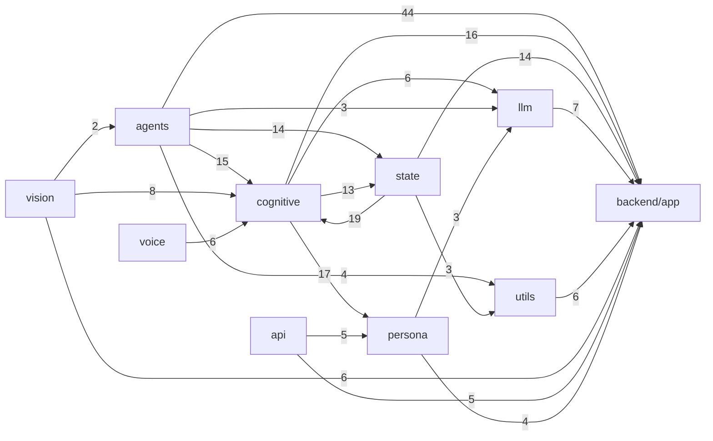
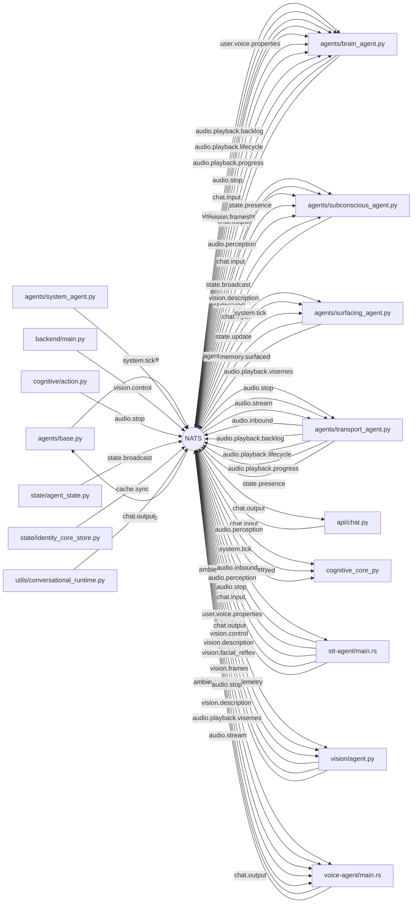

# Architecture map (generated)

Generated by `python -m tools.repo_intel audit` from the structural index at revision `9ab8cb2c4362`. Do not edit by hand; regenerate. Edge confidence tiers: proven (syntax tree resolved), lexical (Rust/JS pattern match), inferred (name match only), unresolved (dynamic or ambiguous), external (outside the repo).

Index: 957 of 957 in-scope files parsed; 11,297 symbols; 25,845 edges.

## 1. Components (code files)

| Component | Code files | Symbols | Files imported by a test |
|---|---|---|---|
| backend/tests | 229 | 4003 | 0 |
| backend/evals | 59 | 689 | 49 |
| backend/scripts | 43 | 207 | 6 |
| backend/app/cognitive | 36 | 471 | 36 |
| backend/app/state | 26 | 474 | 25 |
| frontend | 26 | 71 | 0 |
| tools | 26 | 303 | 12 |
| scripts | 22 | 111 | 1 |
| backend/tools | 18 | 144 | 5 |
| backend/app | 12 | 128 | 11 |
| backend/app/llm | 9 | 79 | 8 |
| backend/app/persona | 9 | 64 | 9 |
| backend/app/agents | 6 | 141 | 5 |
| backend/app/api | 6 | 27 | 4 |
| backend/app/vision | 6 | 54 | 5 |
| backend/crates/stt-agent | 5 | 157 | 0 |
| backend | 5 | 28 | 2 |
| backend/app/utils | 4 | 12 | 4 |
| docs | 4 | 16 | 0 |
| backend/app/voice | 2 | 18 | 1 |
| backend/crates/cognitive-rust | 1 | 44 | 0 |
| backend/crates/contracts | 1 | 68 | 0 |
| backend/crates/voice-agent | 1 | 154 | 0 |

## 2. Import dependencies between `backend/app` packages (proven edges)

| From | To | Imports |
|---|---|---|
| backend/app/agents | backend/app | 44 |
| backend/app/state | backend/app/cognitive | 19 |
| backend/app/cognitive | backend/app/persona | 17 |
| backend/app/cognitive | backend/app | 16 |
| backend/app/agents | backend/app/cognitive | 15 |
| backend/app/state | backend/app | 14 |
| backend/app/agents | backend/app/state | 14 |
| backend/app/cognitive | backend/app/state | 13 |
| backend/app/vision | backend/app/cognitive | 8 |
| backend/app/llm | backend/app | 7 |
| backend/app/voice | backend/app/cognitive | 6 |
| backend/app/utils | backend/app | 6 |
| backend/app/vision | backend/app | 6 |
| backend/app/cognitive | backend/app/llm | 6 |
| backend/app/api | backend/app | 5 |
| backend/app/api | backend/app/persona | 5 |
| backend/app/persona | backend/app | 4 |
| backend/app/agents | backend/app/utils | 4 |
| backend/app/agents | backend/app/llm | 3 |
| backend/app/persona | backend/app/llm | 3 |
| backend/app/state | backend/app/utils | 3 |
| backend/app/vision | backend/app/agents | 2 |
| backend/app/api | backend/app/llm | 2 |
| backend/app/vision | backend/app/llm | 2 |
| backend/app/state | backend/app/persona | 2 |
| backend/app/llm | backend/app/persona | 2 |
| backend/app | backend/app/state | 2 |
| backend/app/api | backend/app/agents | 1 |
| backend/app/persona | backend/app/cognitive | 1 |
| backend/app/api | backend/app/cognitive | 1 |
| backend/app/api | backend/app/state | 1 |

## 3. Runtime entrypoints

96 modules guard a `__main__` block; 9 are outside tests, tools, scripts and evals:

| File | Line |
|---|---|
| backend/app/agents/brain_agent.py | 1827 |
| backend/app/agents/subconscious_agent.py | 969 |
| backend/app/agents/surfacing_agent.py | 710 |
| backend/app/agents/system_agent.py | 73 |
| backend/app/agents/transport_agent.py | 957 |
| backend/app/vision/agent.py | 490 |
| backend/experiments/gpu/real_embedding_retrieval.py | 293 |
| backend/experiments/gpu/tom_valence_affect.py | 139 |
| backend/main.py | 369 |

Rust binaries (`fn main`): `backend/crates/stt-agent/build.rs:52`, `backend/crates/stt-agent/src/main.rs:311`, `backend/crates/voice-agent/src/main.rs:593`

HTTP/WebSocket routes registered by decorator (16):

| Route | File:line |
|---|---|
| WEBSOCKET /ws | backend/app/api/chat.py:94 |
| POST /export | backend/app/api/friend_data.py:27 |
| POST /import | backend/app/api/friend_data.py:50 |
| GET /recent | backend/app/api/memory.py:23 |
| GET /live | backend/app/api/persona.py:99 |
| POST /compile | backend/app/api/persona.py:139 |
| POST /dry-run-chat | backend/app/api/persona.py:156 |
| POST /commit | backend/app/api/persona.py:181 |
| POST /validate | backend/app/api/voice.py:92 |
| POST /commit | backend/app/api/voice.py:113 |
| GET / | backend/main.py:278 |
| GET /status | backend/main.py:287 |
| GET /token | backend/main.py:299 |
| POST /start-session | backend/main.py:316 |
| POST /vision/toggle | backend/main.py:331 |
| GET /health | backend/main.py:360 |

## 4. NATS subject matrix (production code only; tests, tools, scripts excluded)

| Subject | Published by | Subscribed by | Languages | Confidence |
|---|---|---|---|---|
| agent.voice.modulation | agents/surfacing_agent.py | voice-agent/main.rs | py -> rs | lexical/proven |
| ambient.noise.telemetry | stt-agent/main.rs | voice-agent/main.rs | rs -> rs | lexical |
| audio.inbound | agents/transport_agent.py | stt-agent/main.rs | py -> rs | lexical/proven |
| audio.perception | stt-agent/main.rs | agents/subconscious_agent.py, cognitive/core.py | rs -> py | lexical/proven |
| audio.playback.backlog | agents/transport_agent.py | agents/brain_agent.py | py -> py | proven |
| audio.playback.lifecycle | agents/transport_agent.py | agents/brain_agent.py | py -> py | proven |
| audio.playback.progress | agents/transport_agent.py | agents/brain_agent.py | py -> py | proven |
| audio.playback.visemes | voice-agent/main.rs | agents/transport_agent.py | rs -> py | lexical/proven |
| audio.resume | NONE | voice-agent/main.rs | - -> rs | lexical |
| audio.stop | agents/brain_agent.py, cognitive/action.py, stt-agent/main.rs | agents/brain_agent.py, agents/transport_agent.py, voice-agent/main.rs | py/rs -> py/rs | lexical/proven |
| audio.stream | voice-agent/main.rs | agents/transport_agent.py | rs -> py | lexical/proven |
| cache.sync | state/identity_core_store.py | agents/base.py | py -> py | proven |
| chat.input | agents/subconscious_agent.py, api/chat.py, stt-agent/main.rs | agents/brain_agent.py, agents/subconscious_agent.py, agents/surfacing_agent.py, vision/agent.py | py/rs -> py | lexical/proven |
| chat.output | agents/brain_agent.py, utils/conversational_runtime.py | api/chat.py, vision/agent.py, voice-agent/main.rs | py -> py/rs | lexical/proven |
| memory.surfaced | agents/surfacing_agent.py | cognitive/core.py | py -> py | proven |
| state.broadcast | state/agent_state.py | agents/subconscious_agent.py | py -> py | proven |
| state.presence | agents/transport_agent.py | agents/subconscious_agent.py | py -> py | proven |
| state.subconscious | agents/subconscious_agent.py | NONE | py -> - | proven |
| state.update | agents/base.py | agents/surfacing_agent.py | py -> py | proven |
| system.tick | agents/system_agent.py | agents/subconscious_agent.py, agents/surfacing_agent.py, cognitive/core.py | py -> py | proven |
| telemetry.reflection | cognitive/core.py | NONE | py -> - | proven |
| user.voice.properties | stt-agent/main.rs | agents/brain_agent.py | rs -> py | lexical/proven |
| vision.control | backend/main.py | vision/agent.py | py -> py | proven |
| vision.description | vision/agent.py | agents/brain_agent.py, agents/subconscious_agent.py, voice-agent/main.rs | py -> py/rs | lexical/proven |
| vision.facial_reflex | vision/agent.py | agents/brain_agent.py | py -> py | proven |
| vision.frames | vision/agent.py | agents/brain_agent.py | py -> py | proven |
| voice.segmentation_feedback | NONE | agents/brain_agent.py | - -> py | proven |

Published with no production subscriber found (2): `state.subconscious`, `telemetry.reflection`

Subscribed with no production publisher found (2): `audio.resume`, `voice.segmentation_feedback`

A subject listed as orphaned may still be wired through a forwarder, a wildcard, or a call whose subject the extractor could not read. Subjects that stayed unresolved: 13 call sites.

## 5. Persistence touched by code (SQL strings, inferred)

Only tables with a CREATE TABLE statement somewhere in production code are listed (SQL in prose strings produced false names before this filter).

| Table | Created in | Written by | Read by |
|---|---|---|---|
| adaptive_weights | state/adaptive_weights_store.py | state/adaptive_weights_store.py | state/adaptive_weights_store.py |
| agent_configs | runtime_bootstrap.py | persona/reset.py, state/conversation_store.py | state/conversation_store.py |
| agent_proactive_goals | state/agent_state.py | state/agent_state.py | state/agent_state.py |
| agent_state | state/agent_state.py | state/agent_state.py | state/agent_state.py |
| agent_user_activity_hours | state/agent_state.py | state/agent_state.py | state/agent_state.py |
| archived_memories | state/sqlite_fallback.py | state/memory_store.py, state/sqlite_fallback.py | state/memory_store.py |
| belief_reinforcements | state/temporal_store.py | state/temporal_store.py | - |
| beliefs | state/temporal_store.py | state/temporal_store.py | state/temporal_store.py |
| experiences | state/temporal_store.py | state/temporal_store.py | state/temporal_store.py |
| identity_core | state/identity_core_store.py | state/identity_core_store.py | state/identity_core_store.py |
| lexical_associations | state/lexicon_store.py | state/lexicon_store.py | state/lexicon_store.py |
| memories | state/sqlite_fallback.py | state/memory_store.py, state/sqlite_fallback.py | api/memory.py, state/memory_store.py, state/self_knowledge_store.py, state/sqlite_vector_index.py |
| memories_new | state/sqlite_fallback.py | state/sqlite_fallback.py | - |
| messages | runtime_bootstrap.py | state/conversation_store.py, state/memory_store.py | state/conversation_store.py, state/memory_store.py |
| proactive_outreach_queue | state/proactive_queue.py | state/proactive_queue.py | state/proactive_queue.py |
| procedures | state/temporal_store.py | state/temporal_store.py | state/temporal_store.py |
| self_knowledge_gaps | state/self_knowledge_store.py | state/self_knowledge_store.py | state/self_knowledge_store.py |
| sessions | runtime_bootstrap.py | state/conversation_store.py | state/conversation_store.py |
| visual_screen_traces | state/sqlite_fallback.py | state/memory_store.py | - |
| vocabulary | state/lexicon_store.py | state/lexicon_store.py | state/lexicon_store.py |
| working_state | state/working_memory_store.py | state/working_memory_store.py | state/working_memory_store.py |
| working_turns | state/working_memory_store.py | state/working_memory_store.py | state/working_memory_store.py |
| workspace_epoch | state/workspace_store.py | state/workspace_store.py | state/workspace_store.py |
| workspace_state | state/workspace_store.py | state/workspace_store.py | state/workspace_store.py |
| workspace_transitions | state/workspace_store.py | state/workspace_store.py | state/workspace_store.py |

## 6. Environment variables read directly (`os.getenv`, `os.environ`)

45 variables. Settings read through `app/config.py` fields are not listed here.

| Variable | Reads | Files |
|---|---|---|
| NATS_URL | 10 | agents/base.py, backend/scripts/bootstrap/setup_nats_streams.py, backend/scripts/testing/b |
| BRAINBENCH_LLM_URL | 8 | backend/evals/brainbench/__main__.py, backend/evals/brainbench/runner.py, backend/tests/co |
| AI_FRIEND_ENV_PATH | 5 | api/persona.py, api/voice.py, backend/tests/test_config_validation.py, config.py |
| NATS_USER | 5 | agents/base.py, backend/main.py, backend/tests/conftest.py, nats_streams.py, runtime_boots |
| NATS_PASSWORD | 4 | agents/base.py, backend/main.py, backend/tests/conftest.py, nats_streams.py |
| OLLAMA_URL | 4 | backend/scripts/testing/integration_health_check.py, scripts/friend_cli.py, scripts/resear |
| DATABASE_URL | 3 | backend/scripts/db/init_db.py, backend/scripts/db/reset_db.py, backend/scripts/testing/int |
| AI_FRIEND_APP_ROOT | 2 | api/persona.py, api/voice.py |
| CI | 2 | backend/scripts/check_nats_grants.py, backend/tests/conftest.py |
| SCALE_QDRANT_IMAGE | 2 | backend/tools/scale/runner.py |
| AIF_DATA_DIR | 1 | scripts/research/collect_research_data.py |
| AIF_REMOTE | 1 | scripts/research/collect_research_data.py |
| AIF_REMOTE_DIR | 1 | scripts/research/collect_research_data.py |
| AI_FRIEND_HOME | 1 | scripts/friend_cli.py |
| ALLOW_DESTRUCTIVE_DB_RESET | 1 | backend/scripts/db/init_db.py |
| BRAINBENCH_REAL_LLM | 1 | backend/tests/conftest.py |
| BRAINBENCH_TEST_BARRIER | 1 | backend/tests/test_brainbench_runner.py |
| BRAINBENCH_TEST_HARD_EXIT | 1 | backend/tests/test_brainbench_runner.py |
| MEASURE_GRAPH_ENTITIES | 1 | backend/tools/measure/m16_retrieval.py |
| MEASURE_LIVEKIT_URL | 1 | backend/tools/measure/m11_bargein.py |
| MESH_OBSERVED_SUBJECTS | 1 | agents/base.py |
| NATS_AUDIO_MAX_AGE_S | 1 | nats_streams.py |
| NATS_AUDIO_MAX_BYTES | 1 | nats_streams.py |
| NATS_MESSAGES_MAX_AGE_S | 1 | nats_streams.py |
| NATS_MESSAGES_MAX_BYTES | 1 | nats_streams.py |
| NATS_PROVISIONER_USER | 1 | runtime_bootstrap.py |
| NATS_STATE_MAX_AGE_S | 1 | nats_streams.py |
| NATS_STATE_MAX_BYTES | 1 | nats_streams.py |
| NATS_STREAM_SETUP_DELAY_SECONDS | 1 | nats_streams.py |
| NATS_STREAM_SETUP_RETRIES | 1 | nats_streams.py |
| NEO4J_AUTH | 1 | backend/scripts/testing/integration_health_check.py |
| NEO4J_URI | 1 | backend/scripts/testing/integration_health_check.py |
| PROVENANCE_PG_DSN | 1 | backend/scripts/verify_pg_provenance.py |
| REPO_INTEL_DB | 1 | tools/repo_intel/cli.py |
| SCALE_CONTAINER_NAME | 1 | backend/tools/scale/runner.py |
| SCALE_DATABASE_URL | 1 | backend/tests/test_scale_services.py |
| SCALE_NEO4J_IMAGE | 1 | backend/tools/scale/runner.py |
| SCALE_POSTGRES_IMAGE | 1 | backend/tools/scale/runner.py |
| SCALE_QDRANT_HOST | 1 | backend/tools/scale/runner.py |
| SCALE_QDRANT_PINNED_IMAGE | 1 | backend/tools/scale/runner.py |

## 7. Dynamic constructs the index cannot resolve

Absence of a static reference near these is not evidence of non-use.

| Where | Kind | Code |
|---|---|---|
| backend/app/api/persona.py:52 | getattr with a computed name | getattr(Config, setting, None) |
| backend/app/cognitive/__init__.py:34 | dynamic import | import_module(module, __name__) |
| backend/app/cognitive/__init__.py:34 | getattr with a computed name | getattr(import_module(module, __name__), name) |
| backend/app/cognitive/__init__.py:35 | globals | globals() |
| backend/app/cognitive/action_candidate.py:154 | getattr with a computed name | getattr(controls, key, default) |
| backend/app/cognitive/expression.py:52 | getattr with a computed name | getattr(snapshot, name) |
| backend/app/config.py:512 | getattr with a computed name | getattr(self, name) |
| backend/app/config.py:516 | getattr with a computed name | getattr(self, name) |
| backend/app/config.py:520 | getattr with a computed name | getattr(self, name) |
| backend/app/config.py:575 | getattr with a computed name | getattr(self, name, None) |
| backend/app/config.py:761 | getattr with a computed name | getattr(config_instance, name) |
| backend/app/llm/adapter_gate.py:86 | getattr with a computed name | getattr(persona, name) |
| backend/app/persona/profile.py:394 | getattr with a computed name | getattr(meta, attr, None) |
| backend/app/persona/profile.py:398 | getattr with a computed name | getattr(meta, attr, None) |
| backend/app/state/interventions.py:191 | getattr with a computed name | getattr(obj, part) |
| backend/app/state/interventions.py:198 | getattr with a computed name | getattr(obj, leaf) |

(38 more in tests, tools and scripts.)

## 8. Production modules no test imports

4 of 108 `backend/app` modules are not imported by any test (importing is necessary, not sufficient, for coverage):

| Module | Functions/classes |
|---|---|
| backend/app/agents/system_agent.py | 6 |
| backend/app/api/memory.py | 1 |
| backend/app/llm/role_trace.py | 1 |
| backend/app/state/lexicon_seed.py | 0 |

## 9. Documents that cite paths which do not exist

365 unresolved citations in 61 documents (top 30):

| Document | Dead citations | Examples |
|---|---|---|
| .agents/CONTEXT.md | 256 | ./start.sh:12256; ./start.sh:12382 |
| evidence/BENCHMARK_SUMMARY.md | 14 | orchestration/PHASE_01/gpu_benchmark_results.json:134; orchestration/PHASE_01/local_benchmark_results.json:133 |
| docs/brain-v4/research/codex/briefs/common.md | 7 | .../docs/brain-research-v3/05-research-plan.md:25; .../docs/brain-research-v3/11-v2-lifesim-baseline.md:27 |
| scripts/research/research_data_README.md | 6 | reports/brain-v3/08-live-infra-validation.md:20; reports/brain-v3/09-gpu-experiment-results.md:18 |
| docs/brain-v4/phases/04-slice-plan.md | 5 | backend/app/cognitive/belief_extractor.py:126; docs/brain-v4/prereg/slice-NN.md:9 |
| scripts/research/README.md | 4 | docs/ARCHITECTURE.md:34; docs/RESEARCH_GUIDE.md:42 |
| docs/brain-v4/DECISION_LOG.md | 3 | AI_friend/CLAUDE.md:108; evidence/IP_REVIEW_CANDIDATES.md:319 |
| .agents/skills/cognitive-memory/SKILL.md | 3 | assets/templates/agents-memory-block.md:39; reflections/YYYY-MM-DD.md:204 |
| docs/brain-research-v3/README.md | 3 | decisions/DR-001..038-*.md:28; interview/round-1..10.md:27 |
| .agents/skills/python-design-patterns/SKILL.md | 2 | .agents/.agents/skills/python-project-setup/SKILL.md:433; .agents/.agents/skills/python-testing-patterns/SKILL.md:432 |
| academic_benchmarks/documentation/walkthrough.md | 2 | ../datasets/*.json:173; scripts/results/*.json:85 |
| docs/brain-v4/research/phase01-claude/T3-identity.md | 2 | .identity_state/personality.json:138; evals/out/character_pressure_llm_qwen.json:153 |
| academic_benchmarks/documentation/literature_review.md | 2 | _archive/research/hard_benchmark.py:66; audit/ROADMAP.md:14 |
| docs/brain-research-v3/06-benchmark-plan.md | 2 | app/cognitive/clock.py:23; results/HELDOUT_LOG.md:17 |
| evidence/DEMO_SCENARIOS.md | 2 | app/cognitive/temporal_store.py:139; app/transport/barge_in.py:198 |
| evidence/INTEGRATION_BOUNDARIES.md | 2 | app/db/neo4j_client.py:255; app/transport/livekit_transport.py:256 |
| SUPPORT.md | 2 | docs/ARCHITECTURE.md:7; docs/BRINGING_IT_TO_LIFE.md:8 |
| docs/brain-v4/research/phase03-agy/round-1.md | 2 | docs/brain-v4/research/phase01-comparison.md:13; docs/brain-v4/research/phase01-comparison.md:80 |
| docs/brain-research-v3/03-open-questions.md | 2 | interview/round-N.md:3; interview/round-N.md:65 |
| docs/brain-v4/prereg/slice-02.md | 2 | personal/persona.toml:50; prereg/slice-02b.md:41 |
| docs/brain-v4/research/phase03-claude/round-2.md | 2 | scripts/benchmarks/*phase4/6*.py:27; scripts/benchmarks/run_*_phase4.py:23 |
| .claude/skills/postgresql-best-practices/SKILL.md | 1 | .claude/skills/pg-graph/SKILL.md:121 |
| docs/brain-research-v3/results/home-gpu/README.md | 1 | ../../baseline/manifest.json:1 |
| docs/brain-research-v3/results/mac/README.md | 1 | ../../baseline/manifest.json:1 |
| docs/brain-research/adr/ADR-003-barge-in-turn-targeting.md | 1 | ../01-problems.md:3 |
| docs/brain-research/adr/ADR-001-hybrid-memory-retrieval.md | 1 | ../03-memory-retrieval.md:4 |
| docs/brain-research/adr/ADR-002-affect-appraisal-and-weight-learning.md | 1 | ../04-affect-dynamics.md:4 |
| README.md | 1 | _archive/research/hard_benchmark.py:359 |
| docs/brain-v4/research/phase01-compare/T4.md | 1 | app/cognitive/global_workspace.py:56 |
| docs/brain-research-v3/adr/ADR-W10-security.md | 1 | app/state/*_store.py:49 |
