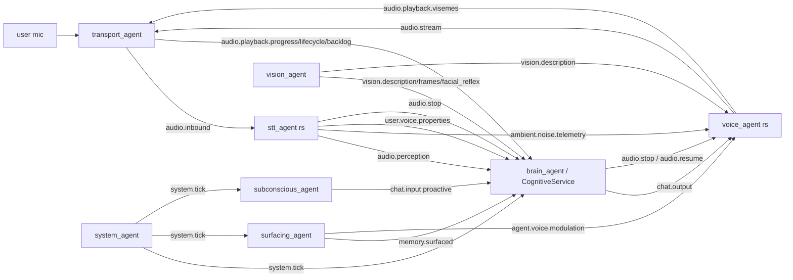

# AI Friend architecture, reconstructed from the code

Written for engineers resuming the Brain V4 roadmap. Basis: revision `e09ca8005999` plus the uncommitted repo-intel tooling, 940 in-scope files parsed (the 920 files of the audited revision were read; the 20 added since are the repo-intel tooling and its reports), 11,085 symbols, 24,101 edges. Every statement below is either read from source, produced by the structural index (confidence stated), or marked as not verified. `#N` refers to a claim in the ledger (`python -m tools.repo_intel claims show N`); the generated tables are in `ARCHITECTURE_MAP.md`.

## 1. What runs

`docker-compose.prod.yml` defines these processes. Nothing in this audit started them.

| Process | Language | Role | Source |
|---|---|---|---|
| `nats_provisioner` | Python | One-shot: creates JetStream streams. Agents no longer provision (F-019). | `backend/scripts/setup_nats_streams.py`, `app/nats_streams.py` |
| `signaling` | Python (FastAPI) | HTTP/WebSocket edge: `/token`, `/health`, `/ws`, `/start-session`, `/vision/toggle`, persona/voice/memory/friend-data routes. 16 decorator routes. | `backend/main.py`, `app/api/*` |
| `brain_agent` | Python | Owns `CognitiveService`; turn loop; barge-in arbitration. | `app/agents/brain_agent.py`, `app/cognitive/core.py` |
| `system_agent` | Python | Emits `system.tick`. | `app/agents/system_agent.py` |
| `subconscious_agent` | Python | Reflection and proactive thought; publishes proactive `chat.input` and `state.subconscious`. | `app/agents/subconscious_agent.py` |
| `surfacing_agent` | Python | Memory retrieval and surfacing; publishes `memory.surfaced` and `agent.voice.modulation`. | `app/agents/surfacing_agent.py` |
| `transport_agent` | Python | LiveKit WebRTC bridge: PCM in and out, playback lifecycle, backlog and progress. | `app/agents/transport_agent.py` |
| `stt_agent` | Rust | Speech to text (whisper.cpp), acoustic features. | `backend/crates/stt-agent` |
| `voice_agent` | Rust | Text to speech, prosody, DSP; publishes `audio.stream` and visemes. | `backend/crates/voice-agent` |
| `vision_agent` | Python | Camera and screen description, facial reflex. Defined in the prod compose behind `profiles: [ vision ]`, so it starts only on request (#40; the ledger saying it is commented out is wrong). | `app/vision/agent.py` |
| `frontend` | TypeScript | Web client. | `frontend/` |

Shared Rust crates: `contracts` (subject constants and message types, mirrored by `app/contracts.py`) and `cognitive-rust` (PyO3 hot path, imported by `app/cognitive/expression.py:15` unconditionally and by `appraisal.py:298` lazily; #25).

## 2. How they talk: the NATS mesh

All cross-process traffic is NATS JetStream. 27 production subjects were resolved (`ARCHITECTURE_MAP.md` section 4). The paths that matter:

Cross-language links the index resolves (confidence `lexical` on the Rust side, `proven` on the Python side): `audio.stream` Rust to Python (#30), `audio.perception` Rust to Python (#31), `audio.inbound` Python to Rust, `agent.voice.modulation` Python to Rust, `chat.output` Python to Python and Rust. These are the links a single-language search misses.

Streams (from `app/nats_streams.py`): `AI_MESSAGES` (7 days, work items), `AI_AUDIO` (`audio.>`, lossy by design), `AI_STATE` (`state.broadcast`, latest message only, full snapshot every time, F-017). `scripts/check_nats_grants.py` derives per-agent publish and subscribe rights from each agent's import closure and fails on any gap or excess grant.

### Wiring gaps found by the subject matrix

| Subject | Finding | Status |
|---|---|---|
| `voice.segmentation_feedback` | Subscribed by `brain_agent.py:289`; nothing in `backend/app` or `backend/crates` publishes it. The handler `_on_voice_feedback` cannot fire. | #32 supported, debt:integration |
| `state.subconscious` | Published at `subconscious_agent.py:774`; no subscriber anywhere. | #34 supported |
| `telemetry.reflection` | Published at `core.py:474`; no subscriber. | #35 supported |
| `audio.resume` | Looked orphaned. It is published through a `mesh_signal` dict that `pipeline.py:212` yields and `CognitiveService.publish` forwards; the Rust agent subscribes. This is an extractor limitation, not a gap. | #33 |
| `cache.sync`, `state.broadcast` | Looked orphaned until helper names containing "publish" were scanned (`publish_cb`). Now resolved. | #37 |

## 3. One turn through the brain

`CognitiveService` (`core.py:52-698`) builds the stores and `CognitivePipeline` (`pipeline.py:66-1035`) and subscribes to `audio.perception`, `memory.surfaced`, `system.tick`. `CognitivePipeline.execute` (`pipeline.py:713`) runs the turn: event extraction, appraisal and state update (`_update_state_from_appraisal`, acoustic and text valence, theory-of-mind after decision), candidate and activation setup gated by `Config.MEMORY_TRUTH_ENABLED` and `AFFECT_CONTROL_ENABLED` (both default `True` in `config.py:220-231`), a streaming action pass (`_stream_action_pass`) with self-correction (`_validate_and_self_correct`), reward-prediction-error and stress updates, and an asynchronous System 2 appraisal. Barge-in handling (speculative intent, `audio.stop` and `audio.resume`, reply ownership) lives in `brain_agent.py` and is pinned by `backend/tests/test_barge_in_real_flow.py` and the mutation tool `backend/scripts/barge_in_mutations.py` (38 mutations, 33 killed, 5 equivalent with written reasons; `docs/brain-research-v3/results/home-gpu/barge_in_mutations.txt`).

## 4. Where state lives

| Store | Technology | Tables or keys | Writer |
|---|---|---|---|
| Memory | Postgres + pgvector in production, SQLite fallback (`sqlite_fallback.py`, `sqlite_vector_index.py`), Qdrant, Neo4j graph boost | `memories`, `archived_memories`, `messages`, `sessions`, `agent_configs` | `MemoryStore`, `ConversationStore` |
| Agent state | Redis cache, SQLite `agent_state`, Neo4j | `agent_state`, `agent_proactive_goals`, `agent_user_activity_hours` | `AgentState` |
| Working memory, workspace | SQLite | `working_state`, `working_turns`, `workspace_state`, `workspace_epoch`, `workspace_transitions` | `working_memory_store`, `workspace_store` |
| Identity | SQLite `identity_core`, persona profile file | `identity_core` | `identity_core_store`, `persona/*` |
| Language | SQLite | `vocabulary`, `lexical_associations` | `lexicon_store` |
| Learning | SQLite | `adaptive_weights`, `proactive_outreach_queue`, `self_knowledge_gaps` | respective stores |
| Temporal truth | SQLite | `beliefs`, `experiences`, `procedures`, `belief_reinforcements` | `temporal_store.py` only |

Table list is the filtered set from `ARCHITECTURE_MAP.md` section 5 (tables with a CREATE TABLE in production code); SQL-string reads and writes are `inferred`.

## 5. Source exists, is referenced, is reachable, is configured, executes, behaves correctly

These are not the same conclusion (directive section 13). For the subsystems where the answer is not "all yes":

| Subsystem | Exists | Referenced | Reachable on the runtime path | Configured | Executes | Behaves correctly |
|---|---|---|---|---|---|---|
| Bi-temporal memory (`TemporalMemoryStore`) | yes | yes: constructed at `core.py:91`, injected at `core.py:166`, stored at `pipeline.py:109` | **no method is called on the instance** anywhere in `backend/app` (#3, runtime grep exit 1) | `TEMPORAL_MEMORY_DB_PATH`; `MEMORY_TRUTH_ENABLED` defaults true | only in tests and `scripts/benchmarks/*phase2*` | store logic tested; "PROVEN" in `evidence/` is a benchmark claim, not production use |
| `voice.segmentation_feedback` handler | yes | yes | no (no publisher) | durable consumer created | never fires | not applicable |
| Playback lifecycle COMPLETED records | yes | yes | yes: `transport_agent.py:573-580` publishes after playout | subject in `contracts.py:50` | not run by this audit | ADR-003 says it never fires in production; that is superseded (#1) |
| Hybrid memory ranking | yes | yes | yes, default (`config.py:333`, #6) | `MEMORY_RANKING_POLICY=hybrid` | ran in the Brain V2 benchmark (`docs/brain-research/`) | held-out hit@3 0.02 to 0.69 reported there; embedding-provenance check covers only one retrieval path (#28) |
| Vision | yes | yes | yes when the `vision` profile is enabled (#40) | `profiles: [ vision ]` in compose | not run by this audit | no live evidence in this audit |
| Learning governor, external action dispatcher, provider negotiator | yes | yes: constructed in `core.py:94-96` | constructed; call sites not traced by this audit | no flags found | tests only | not assessed |
| Brain V3 W1, W2, W3, W11 | no | flags exist only in `evals/brainbench/switchboard.py`; `learning.py` still uses `LearningReviewQueue` (#18) | no | no | no | not applicable |

"Executes" for everything means: not run by this audit. The only execution evidence is the committed test logs (`docs/brain-research-v3/results/`: backend 2,548 passed on the Mac, Rust 179 tests) and the backend suite run recorded in `INFRASTRUCTURE_SAFETY.md`.

## 6. Dynamic behaviour the index cannot see

54 dynamic constructs (`importlib`, computed `getattr`, plugin discovery). 16 sit in production code (`ARCHITECTURE_MAP.md` section 7). Treat "no static reference" near them as a lead. The benchmark shows exactly this failure: a function started through `importlib` is reported as having no caller.

## 7. What this reconstruction does not establish

- Runtime behaviour: nothing was started. No NATS, Postgres, GPU or LiveKit session was used.
- Rust call graphs: lexical only; same-file calls and `mod`/`use` resolution, no trait dispatch.
- The 256 dead citations in `.agents/CONTEXT.md` are historical entries about files that were later removed; they were counted, not individually triaged.
- Quality of the TypeScript frontend: parsed lexically (26 files), not analysed.
